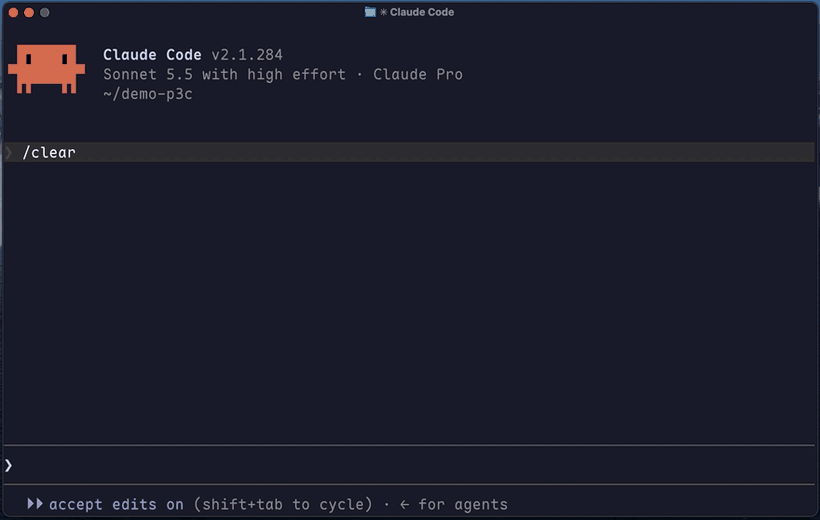

# p3c-guard

**Agent 写 Java 时，违反《阿里巴巴 Java 开发手册》的代码落不了盘。**

一个 Claude Code Mod。它在 `Write` / `Edit` 真正写入 `*.java` 之前跑一遍 p3c 规则，新增了违规就拒绝这次写入，并把规则、行号和改法交还给 Agent，Agent 改对了才能写进去。

[English](README.en.md)



## 效果

Agent 想写这样一个文件：

```java
public class OrderService {
    public boolean run(Integer left, Integer right) {
        ExecutorService pool = Executors.newFixedThreadPool(4);
        pool.shutdown();
        return left == right;
    }
}
```

写入被拒绝，Agent 收到：

```
p3c-guard：这次写入会给 OrderService.java 新增 2 处阿里 Java 规约违规，未写入。
- 第 8 行 [ThreadPoolCreationRule] 手动创建线程池，效果会更好哦。 改法：用 new ThreadPoolExecutor(...) 显式给出核心数、最大数、有界队列和带名字的 ThreadFactory；Spring 项目注入已配置的 ThreadPoolTaskExecutor。
- 第 10 行 [WrapperTypeEqualityRule] 应使用equals方法代替== 改法：用 Objects.equals(a, b) 比较包装类型。
行号是写入后文件里的行号。请修正后重新写入；文件原有的违规不在此列。
```

它会自己改完再写一次。你不用盯着，也不用等到代码审查才发现。

## 安装

在 Claude Code 里输入：

```
/plugin install p3c-guard --marketplace alexlifexyz/p3c-guard
```

需要本机有 **JDK 21 或更高版本**（`java` 在 `PATH` 里）和 `curl`。

第一次遇到 Java 写入时，它会在后台下载规则引擎（13 MB，来自 Maven Central，校验 SHA-256）到 `~/.cache/p3c-guard/`。下载期间的写入不检查，也不会卡住你。

## 它和「规约 Skill」「代码审查」有什么不同

| | 做法 | 什么时候起作用 |
|---|---|---|
| 手册型 Skill | 把规约写成文档给模型读 | 模型记得的时候 |
| 代码审查工具 | 用模型审 diff | 写完之后，你想起来跑的时候 |
| **p3c-guard** | 用语法树规则做确定性检查 | **每一次写入之前** |

检查不经过模型，同样的代码每次结果一样，单个文件约 1 秒。

## 几个设计决定

- **只拦新增的违规。** 老项目的文件本来就有违规，全拦会让 Agent 一行都改不了。它对比写入前后的结果，只对多出来的那几条拒绝。
- **默认只拦严重的。** 规则分三级，默认拦第 1、2 级（线程池、线程安全、包装类比较、集合误用、命名等 32 条），第 3 级（缺 `@author`、魔法值、未指定集合容量等 25 条）不拦。
- **自己出错时放行。** 没装 Java、下载失败、规则引擎崩溃，都放行并在状态栏提示，不会把你的 Java 写入卡死。
- **语法错误的文件放行。** 那是编译器的事。

## 使用

装上就生效，状态栏显示 `p3c 拦 2 · 过 14`。

| 命令 | 作用 |
|---|---|
| `/p3c` | 查看状态和本会话的拦截次数 |
| `/p3c off` | 暂停 |
| `/p3c on` | 恢复 |

配置项 `blockPriority`（在 `/config` 里改）：`1` 只拦最严重的，`2` 为默认，`3` 全拦。

## 已知限制

- **不是整本手册。** 只查 p3c 用代码实现了的 57 条规则。空 `catch` 块、日志规范、SQL 规约等没有对应规则的条目查不到。
- **个别规则会漏。** 例如静态 `SimpleDateFormat` 在 lambda 里调用时查不出。
- **只看 `Write` 和 `Edit`。** Agent 用 shell 命令改文件时不经过它。
- **每台机器的第一次 Java 写入不检查**（规则引擎还在下载）。
- 在 macOS、JDK 23、Claude Code 2.1.293 上测过。Linux 没测，Windows 不支持。
- Claude Code Mods 是 2026-10-01 发布的早期接口，可能随版本变化。

## 规则从哪来

p3c-guard 自己不包含也不分发任何规则实现。它在运行时下载并调用 [loong95/p3c-cmd-jdk21](https://github.com/loong95/p3c-cmd-jdk21)（Apache-2.0），这是把 [alibaba/p3c](https://github.com/alibaba/p3c) 的规则移植到 PMD 7 和 JDK 21 的非官方版本。官方 p3c 的规则引擎停在 PMD 6.15，解析不了 record、switch 表达式、文本块。

本项目与阿里巴巴集团无关，也未获其背书。

## 开发

```
claude plugin validate .
claude plugin test .
claude --plugin-dir .
```

## 许可

MIT，见 [LICENSE](LICENSE) 和 [NOTICE](NOTICE)。
